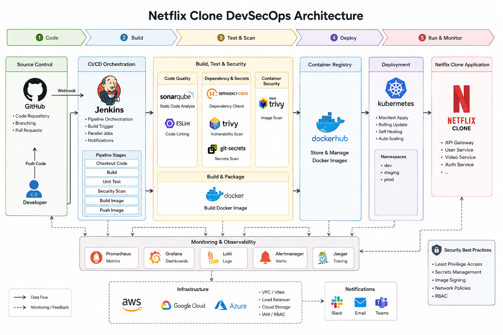
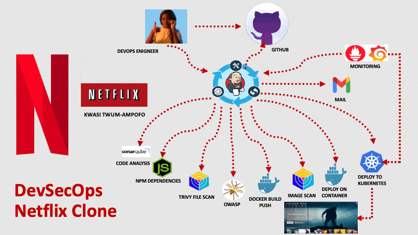
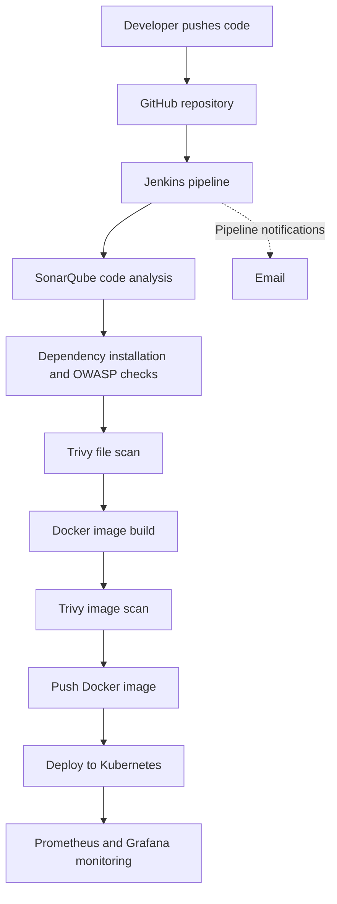

<div align="center">

# 🎬 Netflix DevSecOps CI/CD Pipeline

### 🚀 Automated • Secure • Containerized • Cloud-Native


**An end-to-end DevSecOps project for building, scanning, containerizing, deploying, and monitoring a Netflix-style application.**

[📂 Repository](https://github.com/abhisheksaste31-source/Netflix-DevSecOps-CICD-Pipeline) · [💼 LinkedIn](https://www.linkedin.com/in/abhisheksaste)

</div>

---

## 📌 Project Overview

This project demonstrates a DevSecOps workflow for a Netflix Clone application using **GitHub, Jenkins, SonarQube, OWASP Dependency-Check, Trivy, Docker, Kubernetes, Prometheus, and Grafana**. It brings code analysis and security checks into the CI/CD process, then builds and deploys a containerized application.

> **Note:** This repository demonstrates a production-inspired DevSecOps architecture. Production readiness depends on your actual deployment configuration, access controls, secrets management, and operational testing.

## 🏗️ Architecture Diagram



### 🔄 Animated Pipeline Architecture



> Images are stored in the `architucture/` directory (spelling matches the existing repository folder).

## 🛠️ Technology Stack

| Category | Technology | Purpose |
|---|---|---|
| Source Control | Git & GitHub | Version control and source code management |
| CI/CD | Jenkins | Automate pipeline stages |
| Code Quality | SonarQube | Static code analysis and quality checks |
| Dependency Security | OWASP Dependency-Check | Identify vulnerable dependencies |
| File & Image Security | Trivy | Scan files and container images |
| Runtime & Packaging | Node.js / npm | Install application dependencies |
| Containerization | Docker | Build and publish application images |
| Orchestration | Kubernetes | Deploy and manage containers |
| Monitoring | Prometheus | Collect monitoring metrics |
| Visualization | Grafana | Visualize metrics and dashboards |
| Notifications | Email | Send pipeline notifications |

## ⚙️ CI/CD Pipeline Workflow



### 🔐 Security Checks

- **SonarQube:** Analyze source code quality and maintainability.
- **OWASP Dependency-Check:** Inspect third-party dependencies for known vulnerabilities.
- **Trivy filesystem scan:** Check project files for security issues.
- **Trivy image scan:** Scan the built container image before deployment.

## 🚀 Getting Started

### 1. Clone the repository

```bash
git clone https://github.com/abhisheksaste31-source/Netflix-DevSecOps-CICD-Pipeline.git
cd Netflix-DevSecOps-CICD-Pipeline
```

### 2. Prepare the environment

Install and configure the components required by your pipeline:

- Jenkins with the necessary pipeline and tool integrations
- Git, Node.js/npm, Docker, and Kubernetes CLI (`kubectl`)
- SonarQube, OWASP Dependency-Check, and Trivy
- Access to a container registry and a Kubernetes cluster
- Prometheus and Grafana for monitoring

### 3. Configure Jenkins

1. Create a Jenkins Pipeline job.
2. Connect the GitHub repository and select the `main` branch.
3. Configure tool installations, SonarQube integration, and credentials as required by your Jenkinsfile.
4. Set up container registry credentials and Kubernetes deployment access.
5. Run **Build Now** and inspect each pipeline stage.

> ⚠️ The exact Jenkins tool names, credential IDs, container image, and Kubernetes manifests must match the files in your repository. Never commit passwords, tokens, or kubeconfig secrets.

### 4. Verify deployment

```bash
kubectl get deployments
kubectl get pods
kubectl get services
```

Confirm the application is reachable through the service or ingress configured for your cluster, and review your Prometheus/Grafana dashboards.

## 📂 Architecture Assets

```text
Netflix-DevSecOps-CICD-Pipeline/
├── README.md
└── architucture/
    ├── Architecture-latest.png
    └── architecture.gif
```

*This tree highlights the README and architecture images; other project files are not shown.*

## 🎯 Key Learning Outcomes

- Automating application delivery with Jenkins and GitHub
- Integrating code-quality and vulnerability scanning into CI/CD
- Building and publishing Docker images
- Deploying containerized applications to Kubernetes
- Monitoring applications using Prometheus and Grafana

## 👨‍💻 Author

**Abhishek Saste**

- 💼 **LinkedIn:** [linkedin.com/in/abhisheksaste](https://www.linkedin.com/in/abhisheksaste)
- 💻 **GitHub:** [abhisheksaste31-source](https://github.com/abhisheksaste31-source)
- 📁 **Project:** [Netflix-DevSecOps-CICD-Pipeline](https://github.com/abhisheksaste31-source/Netflix-DevSecOps-CICD-Pipeline)

---

<div align="center">

### ⭐ If you find this project useful, consider starring the repository!

**Built with ❤️ for DevSecOps learning and hands-on automation.**

</div>
